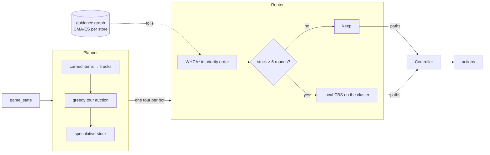

<div align="center">

# 🛒 Grocery Bot

**A multi-robot warehouse bot for [Grocery Bot](https://grocerybot.no/how-to-play) (NM i AI)**
*no neural nets, no reinforcement learning: auctions, time-space search and statistics*


</div>

---

A team of robots picks items from shelves and loads them into trucks that come and go. Five stores,
from **Easy** (1 bot) to **Nightmare** (a crowd sharing one-lane corridors). 300 rounds, and every bot
moves at once.

The bot is a **three-layer hierarchy**, and every layer is measured:



Every change has to win a **paired SPRT** against the previous frozen version, played on the official
local engine, before it is kept.

## Results

CLI mean score over seeds 5000–5009:

| Store | Starter bot | v5 | Gain |
| --- | ---: | ---: | ---: |
| Easy | 144 | 153 | +6 % |
| Medium | 161 | 211 | +31 % |
| Hard | 150 | 241 | +61 % |
| Expert | 118 | 256 | **+117 %** |
| Nightmare | 208 | 590 | **+184 %** |

v6 and v7 improve on top of this (see [the version history](#version-history)); v7 adds about +33
points per game on Nightmare.

## Scoring

Each item loaded into the right truck scores 1, and the load that completes an order adds a bonus:

```math
\text{score} \;=\; \sum_{\text{items}} 1 \;+\; 5 \cdot \#\{\text{completed orders}\}
```

So a bot carrying the *last* item of an order is worth a lot more than one carrying the first.

---

## 1 · Planner: a greedy tour auction

A **tour** is up to three pickups followed by one load cell of one truck. For a bot at $p$ visiting
pickup cells $c_1,\dots,c_k$ (each the nearest cell of its item type from the previous one) and
finishing at the nearest load cell $L$:

```math
\text{cost} \;=\; \sum_{i=1}^{k} \bigl(d(c_{i-1}, c_i) + 1\bigr) \;+\; d(c_k, L), \qquad c_0 = p
```

where $d$ is the exact all-pairs shortest-path distance (the `+1` is the pick-up round). The truck may
still be away, so the tour is ready no earlier than it returns:

```math
r \;=\; \max\bigl(\text{cost},\; \texttt{rounds\_until\_back}\bigr) + 1
```

A tour delivering $n$ items (carried plus picked) to an order of size $|O|$ is worth its share of the
order bonus, and the bot bids **points per round**:

```math
v \;=\; n + 5\,\frac{n}{|O|}, \qquad
\text{bid} \;=\; \frac{v}{r}\cdot
\begin{cases} 1.25 & \text{same tour as last round (hysteresis)}\\ 1 & \text{otherwise}\end{cases}
```

Every pickup combination and order is tried (≤ 3 items, so it's cheap). The auction then repeats:
**commit the single highest bid**, remove its items from that truck's residual demand, recompute only
the bids for that truck, and stop when nobody bids. Bots left without a tour may **stock** slow-to-fetch
item types on speculation (only on sparse stores, $\le 0.06$ bots per walkable cell).

## 2 · Router: WHCA\* + local CBS

### Time-space A\*

Bots are planned one at a time in priority order through a reservation table over $(cell, t)$ for a
window of $W = 12$ rounds, with the engine's exact collision rules (no shared cells, no swaps, and at
$t = 0$ a bot may follow into a vacated cell only behind a lower ID, because moves resolve in ID order).

The priority of bot $b$ sorts by

```math
\kappa(b) \;=\; \bigl(\;4\cdot\text{rank}(b) - \text{waited}(b),\;\; d(b, \text{goal}_b),\;\; b\;\bigr)
```

with $\text{rank} = -1$ for bots serving a docked truck, $0$ heading to a truck, $1$–$2$ picking, and
$3$ idle. Four rounds of waiting buy one priority class (aging), so nobody starves.

Each step $a \to b$ costs one round plus the **guidance tolls**, which are switched off within 2 cells of
the goal:

```math
c(a \to b) \;=\;
\begin{cases}
1 & d(b, g) \le 2\\[2pt]
1 + \tau_{\text{lane}}\,\mathbb{1}[b \in \text{load row}] + w_{k(a,b)} & \text{otherwise}
\end{cases}
```

and A\* runs on $f = g + h$ with $h$ the *toll-aware* distance to the goal. Ties are broken against
waiting early (penalty $W - t$ per wait), otherwise a bot that should make way plans "wait, then go",
replans the same thing next round, and never goes.

### Local conflict-based search

Prioritized planning can't solve a head-on meeting in a dead end. A bot is **stuck** when

```math
\text{arrival}(b) - d(\text{start}_b, \text{goal}_b) \;\ge\; 6
```

and then it and the bots blocking its shortest path (at most 4) are planned **jointly** with CBS
(Sharon et al., 2015) against everyone else's reservations. The joint plan is kept only if the weighted
total arrival improves:

```math
J \;=\; \sum_{b} \omega_b \cdot \text{arrival}(b), \qquad
\omega_b = \begin{cases} 8 & b \text{ is headed to a truck}\\ 1 & \text{otherwise}\end{cases}
```

Unweighted, CBS happily sends a bot one step from its truck backwards to let a picker pass.

## 3 · Guidance graph, tuned with CMA-ES

The store layout is identical for every seed, so the road network can be tuned **offline, per store**
(inspired by guidance-graph optimization for lifelong MAPF,
[arXiv 2411.16506](https://arxiv.org/abs/2411.16506)). A full edge-weight table has ~900 entries, so the
weights are tied to a few layout-derived parameters $\theta$:

| Parameter | Applies to |
| --- | --- |
| $w_{(\text{v},x,\updownarrow)}$ | vertical moves in aisle column $x$, per direction |
| $w_{(\text{vc},\updownarrow)}$ | vertical moves between corridor rows |
| $w_{(\text{h},y,\leftrightarrow)}$ | horizontal moves along corridor row $y$, per direction |
| $w_{(\text{ha},\leftrightarrow)}$ | sideways moves between adjacent aisles |
| $\tau_{\text{lane}}$ | every round spent on the load row |

CMA-ES maximizes the mean simulated score, with every candidate of a generation playing the **same**
seeds (common random numbers) and fresh seeds each generation, so selection can't overfit a few games:

```math
\theta^\star \;=\; \arg\max_{\theta \,\in\, [-1,6]^m} \; \frac{1}{|S_g|}\sum_{s \in S_g} \text{score}\bigl(s;\, \max(\theta, 0)\bigr)
```

The CMA mean and the four best candidates are then re-scored on 24 untouched validation seeds (from
100000), and the winner is saved only if it beats the hand-set default.

**Nightmare, 60 generations × 6 seeds:** validation score 656.1 vs 614.8 (**+6.7 %**), confirmed by SPRT.

## 4 · Statistics: paired SPRT

Two bots play the same `(store, seed)` games, with differences $d_i = \text{new}_i - \text{old}_i$.
After a 20-game pilot fixes $\hat\sigma^2$ and $\delta = \max(1\%\cdot\overline{\text{old}},\, 1)$, a
Gaussian sequential probability ratio test runs with $H_0: \mu = 0$ against $H_1: \mu = \delta$ (and a
mirrored one against $-\delta$ for regressions):

```math
\Lambda_n \;=\; \sum_{i=1}^{n} \frac{\delta}{\hat\sigma^2}\Bigl(d_i - \frac{\delta}{2}\Bigr),
\qquad
\text{stop when}\;\;
\Lambda_n \ge \ln\frac{1-\beta}{\alpha}
\;\;\text{or}\;\;
\Lambda_n \le \ln\frac{\beta}{1-\alpha}
```

with $\alpha = 0.05$ and $\beta = 0.10$. A few deadlocked games give $d$ heavy tails, so a **sign test**
runs alongside ($W$ wins, $L$ losses, $p = 0.6$ against $0.5$):

```math
\Lambda^{\pm}_n \;=\; W \ln\frac{0.6}{0.5} \;+\; L \ln\frac{0.4}{0.5}
```

Either test may stop the run, but only if the other points the same way. Seeds from 20000 up are a
holdout that the tooling refuses without `--holdout`.

---

## Version history

Each version was accepted by SPRT against the one before. Values are mean $d$ per game:
Easy / Medium / Hard / Expert / Nightmare.

| Version | Change | Mean $d$ vs previous |
| --- | --- | --- |
| `starter` | The provided starter bot | – |
| `v2_prio` | Tour auction + WHCA\* router | +5 / +46 / +87 / +112 / +126 |
| `v2_cbs` | Local CBS for stuck clusters | 0 / +0.5 / +2.4 / +4.5 / **+69** |
| `v3_toll` | Load-row toll | – / – / +1.8 / +11 / **+202** |
| `v4` | Speculative stocking (off on dense stores) | – / +2.6 / +2.2 / +17 / off |
| `v5` | Load only into your own tour's truck | +2.4 / +2.8 / +7.5 / +3.4 / +17.8 |
| `v6` | Bots serving a docked truck route first | 0 / +12.5 / +1.5 / +5.8 / +10.8 |
| **`v7`** | **CMA-ES guidance graph for Nightmare** | – / – / – / – / **+32.8** (W/L 20/4) |

Tried and rejected by measurement: one-way aisles, parking idle bots on spawn, traffic-based parking,
capping pickups per tour, moving bottleneck picks to idle bots, and loading into any passing truck.

## Quick start

```sh
grocerybot login
grocerybot play --store easy            # runs bot_v2.py (see grocerybot.toml)
python3 -m unittest discover -s tests -t .
```

The bot needs only the Python 3 standard library. The protocol (one JSON object per line on
stdin/stdout, logs on stderr) is in [PROTOCOL.md](PROTOCOL.md).

### Tooling

```sh
# Compare two frozen versions (SPRT)
python3 tools/sprt.py --store nightmare --old "python3 -u baselines/v6/bot_v2.py" --new "python3 -u baselines/v7/bot_v2.py"

# Record a game, then check that the local engine reproduces it exactly
grocerybot practice --store medium --seed 7 -- python3 -u tools/record.py --out recordings/m7.jsonl -- python3 -u bot_v2.py
python3 -m grocery_ai.sim.fidelity recordings/*.jsonl

# Per-round trace: each bot's plan, router mode, goal and path
GROCERY_TRACE=trace.jsonl grocerybot practice --store hard --seed 3

# Tune a store's guidance graph (needs cma, kept out of the bot)
python3 -m venv .venv-opt && .venv-opt/bin/pip install cma numpy
.venv-opt/bin/python tools/guidance_opt.py --store expert --generations 60 --seeds 6
```

> [!WARNING]
> **Always compare frozen copies.** `sprt.py` starts a fresh bot process per game, and it imports
> `grocery_ai/` from disk, so editing code mid-run silently changes the candidate. Copy both bots into
> `baselines/<name>/` first. Likewise, a guidance file saved by `guidance_opt.py` is used by `bot_v2.py`
> right away: confirm it with an SPRT before keeping it.

## Repository layout

```
bot_v2.py              the bot (entry point in grocerybot.toml)
grocery_ai/
  core/                static map + all-pairs distances, parsed game state
  plan/                tour generation and the auction planner
  route/               WHCA* (whca.py), local CBS (cbs.py), guidance graph (guidance.py, guidance/*.json)
  control/             tours + routes → one action per bot
  sim/                 exact rules engine, fidelity check, self-play without the CLI
tools/                 sprt.py · guidance_opt.py · record.py · fuzz_bot.py
baselines/             every accepted version, frozen
recordings/            one recording per store (selfplay.py reads the layouts from them)
tests/                 engine, router and guidance tests
```

<div align="center"><sub>Built for NM i AI · measured, not guessed</sub></div>
